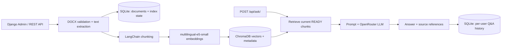

# Document QA — Multilingual Document Question Answering with RAG

[فارسی / Persian README](README_FA.md)

**A Django-based Retrieval-Augmented Generation (RAG) application that turns Word documents into a searchable knowledge base and answers natural-language questions with source references.**

Built as an end-to-end **AI engineering internship project**, with a focus on modular services, document processing, semantic retrieval, API design, failure recovery, and reproducible evaluation. The main use case is **Persian-language question answering**, while the embedding model supports multilingual queries.

> **Project scope:** a working local-development/demo application, not a production-hosted service. Django Admin provides the management interface; no separate frontend is required.

## At a glance

| What it does | How it works |
| --- | --- |
| Document management | Upload, inspect, replace, and delete `.docx` files from Django Admin or an authenticated REST API |
| Text extraction | Read paragraphs and tables with `python-docx` and store extracted content in SQLite |
| Semantic search | Split text into overlapping chunks, embed with local `intfloat/multilingual-e5-small`, and index in ChromaDB |
| Grounded Q&A | Retrieve relevant chunks and generate an answer using a configurable OpenRouter LLM |
| Source attribution | Return the document/chunk references used to construct the answer |
| Q&A history | Store successful question–answer interactions and let users view their own history |
| Index reliability | Track `pending`, `processing`, `ready`, and `failed` states; retry failed indexing; exclude stale indexes from search |
| Quality checks | Run Django tests, offline retrieval evaluation, optional LLM evaluation, and human answer review |

## Architecture



**Key design choices**

- **Local embeddings, hosted generation:** E5 embeddings run locally (CPU), while OpenRouter handles LLM inference. The embedding model is not fine-tuned on uploaded documents.
- **Separate operational and semantic storage:** SQLite stores source documents and application state; ChromaDB stores searchable vectors.
- **Index-state awareness:** only vectors belonging to the current `READY` document index are eligible for retrieval. Failed operations can be retried without uploading the document again.
- **Avoid unnecessary computation:** changing only document metadata does not require regenerating all embeddings; replacing changed content does.
- **Explicit service boundaries:** document lifecycle, DOCX parsing, chunking, embeddings, vector search, RAG, and HTTP views are kept in separate modules.

## Technology stack

| Layer | Technologies |
| --- | --- |
| Backend & API | Python 3.11, Django 5.2, Django REST Framework |
| Document ingestion | `python-docx` |
| RAG & text splitting | LangChain |
| Local embedding | `intfloat/multilingual-e5-small`, Sentence Transformers |
| Vector database | ChromaDB |
| LLM inference | OpenRouter (configurable model) |
| Data & history | SQLite |
| Environment | Docker, Docker Compose |
| Testing & evaluation | Django test framework, mocked external dependencies, Persian evaluation fixtures, CSV/JSON reports |

## Run locally

**Prerequisites:** Docker Desktop / Docker Compose, and an OpenRouter API key to generate answers. Internet access is needed for initial embedding-model download and LLM requests.

```powershell
# From the repository root (containing manage.py)
Copy-Item .env.example .env
```

Set the appropriate values in your local `.env` (never commit it):

```dotenv
DJANGO_SECRET_KEY=replace-with-a-unique-secret
DJANGO_DEBUG=True
DJANGO_ALLOWED_HOSTS=localhost,127.0.0.1
OPENROUTER_API_KEY=your-private-key
OPENROUTER_MODEL=your-available-openrouter-model
```

```powershell
docker compose up -d --build
docker compose exec web python manage.py migrate
docker compose exec web python manage.py createsuperuser
docker compose exec web python manage.py check
```

Open **Django Admin** at `http://127.0.0.1:8000/admin/` or the **Browsable API** at `http://127.0.0.1:8000/api/documents/`. Upload a DOCX document; when its `index_status` becomes `ready`, it can be queried without running a separate indexing command.

> The Compose configuration is designed for a local demo. Before using real/private documents, review access controls, remote LLM data transfer, persistent storage, and backup settings.

## API endpoints

All document and question endpoints below use Django authentication (session or HTTP Basic). **The current MVP uses `IsAuthenticated` for document CRUD and retry-index**: any authenticated user can manage the shared document collection. There is no custom staff-only permission policy in this version. Question history is filtered to the current user.

| Method | Endpoint | Purpose |
| --- | --- | --- |
| `GET`, `POST` | `/api/documents/` | List or upload documents |
| `GET`, `PATCH`, `DELETE` | `/api/documents/{id}/` | View, edit, replace, or delete a document |
| `POST` | `/api/documents/{id}/retry-index/` | Retry a failed/incomplete index |
| `POST` | `/api/ask/` | Ask a question over indexed documents |
| `GET` | `/api/history/` | Read paginated question history for the signed-in user |
| `GET` | `/api/history/{id}/` | Read one of the user's history entries |
| `GET` | `/health/` | Basic health endpoint |

Example request to `POST /api/ask/`:

```json
{
  "question": "موضوع اصلی سند چیست؟",
  "k": 4,
  "document_id": 7
}
```

`document_id` is optional; omit it to search across all `READY` documents. The answer response includes `question`, `answer`, and `sources`. Document upload uses `multipart/form-data` with `title` and `file` fields (`.docx` only; the API validates file type and size).

**Why does `GET /api/documents/7/retry-index/` return 405?** The endpoint is a custom Django REST Framework action declared with `@action(detail=True, methods=["post"], url_path="retry-index")` on `DocumentViewSet`. The router creates its URL automatically; retrying is an operation, not a page to retrieve.

## Testing & quality evaluation

Run the project's Django tests:

```powershell
docker compose exec web python manage.py test
```

Run local report-helper tests if `scripts/` has been added to your checkout:

```powershell
python -m unittest discover -s scripts/tests -v
```

An optional evaluation pipeline uses **two synthetic Persian DOCX documents** (`quality_eval/aban.docx`, `quality_eval/narvan.docx`) and **16 labeled Persian questions**. After uploading them and noting their document IDs:

```powershell
# Retrieval-only: no OpenRouter calls
# Replace 7 and 8 with the actual uploaded IDs.
docker compose exec web python manage.py evaluate_rag_quality --document-a 7 --document-b 8 --k 4

# Optional live answer evaluation: consumes LLM quota
docker compose exec web python manage.py evaluate_rag_quality --document-a 7 --document-b 8 --k 4 --with-llm
```

The evaluation records retrieval hits, evidence matches, citation-number checks, response latency, provider errors, and answers for human review. If the quality-summary helper is present, it can convert the JSON report and graded CSV into a Markdown summary.

**Observed small-sample result (project-owner manual review):** 15 of 16 prompts received answers and all 15 received answers were rated correct; one prompt failed because of an external provider error. This is **15/15 among completed responses**, **15/16 request completion**, and **not a claim of 100% general accuracy**. Retrieval metrics, citation support, and performance should be taken from the actual evaluation reports rather than inferred from this observation.

## Engineering skills demonstrated

This project demonstrates practical experience with:

- Designing and testing **REST APIs** with serializers, authentication, pagination, and structured errors.
- Building a complete **RAG ingestion/retrieval/generation pipeline** rather than only calling an LLM API.
- Integrating **local embedding inference** and a persistent vector store with a traditional database.
- Handling **partial failures** across SQLite, ChromaDB, and an external inference provider through indexing states, retries, and controlled error responses.
- Writing **unit/integration tests**, including mocked external services and test-only vector stores.
- Running a **reproducible Docker-based development environment** and measuring model quality separately from provider availability.

## Scope and trade-offs

- **Shared documents:** authenticated users can currently view and modify the same corpus. Granular write permissions or per-user document ownership would be needed for an untrusted multi-user deployment.
- **Hosted LLM:** selected retrieved passages are sent to OpenRouter; do not upload confidential information without a suitable data policy.
- **Availability:** free LLM providers can return `429` rate limits or `504` timeouts; these failures are not evidence of incorrect semantic retrieval.
- **Processing cost:** embeddings run synchronously on CPU, so large uploads may be slow.
- **Consistency:** SQLite and ChromaDB have no cross-database atomic transaction. Index status, version filtering, and retry mitigate some failure cases but are not a full distributed transaction.
- **Deployment:** local Docker setup uses development-oriented settings; public deployment needs hardened authentication/permissions, HTTPS, production hosting, logging, and backup/restore procedures.

**Possible next iterations (not yet implemented):** asynchronous indexing jobs, document-level authorization, larger multilingual evaluation datasets, retrieval reranking, production monitoring, and optimized embedding inference.

---

*Developed as a practical AI engineering internship assignment, focusing on end-to-end delivery, correctness, and maintainability rather than adding unnecessary infrastructure.*
