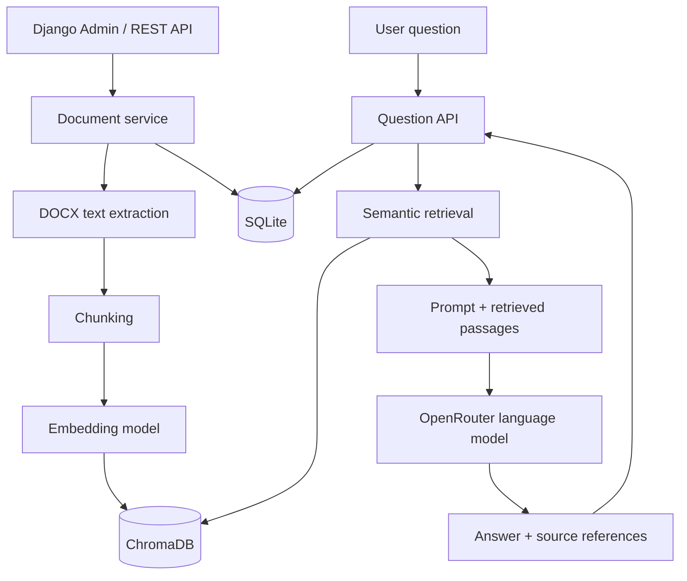

# Document QA — Retrieval-Augmented Question Answering

A document-based question-answering system built with **Django** and **LangChain**. Users can upload Microsoft Word documents (`.docx`), search their contents semantically, and ask natural-language questions. The system is designed to retrieve relevant passages and use a language model to generate answers grounded in the uploaded documents.

The project prioritizes **readability, modularity, and ease of deployment** over unnecessary complexity. Django Admin provides the management interface, and REST APIs provide programmatic access; a separate frontend is not required.

> **Project status:** Work in progress. This README describes the complete intended system. The current checkout may not yet implement every feature or endpoint listed under **Planned Features** and **Proposed API**. Refer to the code and tests for currently available functionality.

## What Problem Does It Solve?

Finding an answer in a long collection of Word documents can be slow and frustrating. Traditional keyword search may miss relevant sections when a question uses different wording from the source text.

Document QA uses **Retrieval-Augmented Generation (RAG)** to:

1. Extract text from uploaded Word documents.
2. Split the text into smaller, searchable passages.
3. Convert passages into vector representations (embeddings).
4. Retrieve passages most relevant to the user's question.
5. Send the question and retrieved context to a language model.
6. Return a grounded answer with references to the source documents.

The language model is **not trained or fine-tuned** on the uploaded files. Instead, relevant document content is provided to the model at question-answering time.

## Planned Features

- **Document management:** Upload, list, inspect, update, and delete `.docx` documents.
- **Text extraction:** Extract and store document text for processing and auditing.
- **Semantic search:** Find related passages even when the question and document use different wording.
- **Document-grounded answers:** Generate answers using retrieved passages instead of relying only on general model knowledge.
- **Source references:** Include the documents and passages used to answer each question.
- **Question history:** Store past questions, answers, references, and timestamps.
- **REST API:** Make document management, Q&A, and history accessible through HTTP endpoints.
- **Django Admin:** Manage documents and review questions without a separate frontend.
- **Docker support:** Run the application in a reproducible development environment.
- **Error handling and tests:** Handle invalid uploads, empty documents, failed model requests, and other expected errors.

## Technology Stack

| Layer | Technology | Purpose |
| --- | --- | --- |
| Language | Python 3.11 | Application language |
| Web framework | Django 5.2 LTS | Application structure, data models, Admin, authentication |
| REST API | Django REST Framework *(planned)* | HTTP endpoints and serializers |
| Relational database | SQLite | Document metadata and question history |
| Word processing | `python-docx` *(planned)* | `.docx` text extraction |
| RAG orchestration | LangChain *(planned)* | Connect splitting, retrieval, prompts, and the language model |
| Embedding model | `intfloat/multilingual-e5-small` *(planned)* | Multilingual text embeddings |
| Vector database | ChromaDB *(planned)* | Semantic indexing and similarity search |
| LLM provider | OpenRouter *(planned)* | API access to a configurable language model |
| Deployment | Docker + Docker Compose | Reproducible local development |

**Why these choices?** The stack is intentionally small: SQLite is sufficient for an initial single-instance application, ChromaDB provides a simple local vector store, and OpenRouter avoids hosting a large language model locally. The chosen free model, if available, can be configured through an environment variable; free-model availability and request limits may change.

## Architecture



### Main Components

- **Django / API:** Receives user requests, validates inputs, and coordinates services.
- **Document service:** Handles file uploads, metadata, extracted text, and indexing lifecycle.
- **Text processing:** Extracts text and splits it into overlapping chunks.
- **Embedding service:** Converts documents and queries into vectors using the same model.
- **Vector store:** Retrieves chunks that are semantically close to the question.
- **RAG service:** Builds a prompt from retrieved chunks and calls the language model.
- **History storage:** Records questions, answers, source references, and timestamps.

The components are intended to remain small and replaceable. For example, the embedding model or language-model provider can be changed without rewriting Django models or API endpoints.

## Getting Started

### Prerequisites

- **Docker Desktop** with Docker Compose (recommended), **or** Python 3.11 for local installation.
- Git (optional, for cloning the repository).
- An OpenRouter API key **when the LLM integration is enabled**.
- Internet connectivity for the hosted language model and any first-time model downloads.

### Option A — Run with Docker (recommended)

Clone the repository, or open its extracted project folder:

```powershell
git clone https://github.com/<YOUR_USERNAME>/<YOUR_REPOSITORY>.git
cd <YOUR_REPOSITORY>
```

If you already have the project folder locally, skip the cloning step.

Create a local environment file:

```powershell
Copy-Item .env.example .env
```

Review the settings in `.env`, then start the application:

```powershell
docker compose up --build -d
```

Create a Django administrator account:

```powershell
docker compose exec web python manage.py createsuperuser
```

Open:

- **Django Admin:** <http://127.0.0.1:8000/admin/>
- **Health check:** <http://127.0.0.1:8000/health/>

Useful commands:

```powershell
docker compose ps
docker compose logs -f web
docker compose exec web python manage.py check
docker compose exec web python manage.py test
docker compose down
```

`docker compose down` stops the stack without deleting named volumes. **Do not run `docker compose down -v` unless you intentionally want to delete persistent volume data.**

> **Development setup:** The Compose configuration uses Django's development server and binds port 8000 to localhost. It is not a production deployment configuration.

### Option B — Run Locally on Windows (PowerShell)

From the repository root:

```powershell
py -3.11 -m venv .venv
.\.venv\Scripts\python.exe -m pip install -r requirements.txt
Copy-Item .env.example .env
.\.venv\Scripts\python.exe manage.py migrate
.\.venv\Scripts\python.exe manage.py createsuperuser
.\.venv\Scripts\python.exe manage.py runserver
```

Visit <http://127.0.0.1:8000/admin/>. To stop the development server, press `Ctrl+C`.

### Environment Configuration

The environment file is local to your machine and must **never** be committed to Git.

| Variable | Role | Status |
| --- | --- | --- |
| `DJANGO_SECRET_KEY` | Secret used by Django | Required now |
| `DJANGO_DEBUG` | Enable/disable Django debug mode | Available now |
| `DJANGO_ALLOWED_HOSTS` | Allowed HTTP hostnames | Available now |
| `DJANGO_DB_PATH` | SQLite database path | Optional; used by Docker |
| `OPENROUTER_API_KEY` | Authenticate with OpenRouter | Planned for LLM integration |
| `OPENROUTER_MODEL` | Select the LLM at runtime | Planned for LLM integration |

The current `.env.example` contains Django settings. Add the OpenRouter variables when the integration is implemented; do not assume they are recognized by the current code yet.

A possible future addition to `.env` is:

```dotenv
# Add only after the OpenRouter integration is implemented.
OPENROUTER_API_KEY=your-api-key-here
OPENROUTER_MODEL=your-selected-model-id
```

Keep `.env` out of version control; commit `.env.example` with non-sensitive placeholders instead.

## Proposed API

The following endpoints describe the **target interface**. Endpoints may not be available until their corresponding features are implemented.

| Method | Endpoint | Purpose |
| --- | --- | --- |
| `GET` | `/api/documents/` | List uploaded documents |
| `POST` | `/api/documents/` | Upload a Word document |
| `GET` | `/api/documents/{id}/` | Get document details |
| `PATCH` | `/api/documents/{id}/` | Update document metadata or file |
| `DELETE` | `/api/documents/{id}/` | Delete a document and its search index entries |
| `POST` | `/api/ask/` | Ask a question about the uploaded documents |
| `GET` | `/api/history/` | List saved questions and answers |
| `GET` | `/api/history/{id}/` | Get an individual Q&A record |
| `GET` | `/health/` | Application health check |

### Example: Upload a Document

*Illustrative request for the planned API:*

```bash
curl -X POST http://127.0.0.1:8000/api/documents/ \
  -F "title=Introduction to AI" \
  -F "file=@sample.docx"
```

### Example: Ask a Question

*Illustrative request for the planned API:*

```bash
curl -X POST http://127.0.0.1:8000/api/ask/ \
  -H "Content-Type: application/json" \
  -d '{"question":"What is deep learning?"}'
```

*Illustrative response schema (subject to implementation):*

```json
{
  "answer": "Deep learning is a subset of machine learning ...",
  "sources": [
    {
      "document_id": 1,
      "title": "Introduction to AI",
      "chunk_id": "example-chunk-id"
    }
  ]
}
```

Responses should not invent supporting citations. If retrieval does not provide sufficient evidence, the system should explain that it cannot answer reliably from the available documents.

## How Retrieval Works

**Document ingestion** happens when a file is uploaded or updated:

`DOCX -> extracted text -> text chunks -> embeddings -> ChromaDB`

**Question answering** happens for each query:

`question -> query embedding -> relevant chunks -> prompt -> LLM -> answer + sources`

For the planned multilingual E5 embedding model, the implementation should use `passage:` prefixes for indexed passages and `query:` prefixes for questions. Chunk size, overlap, and retrieval count should be configurable and evaluated against example documents instead of assumed optimal.

On document updates or deletion, corresponding vector records must also be updated or removed to prevent stale search results.

## Testing and Quality Checks

Run the current Django test suite locally:

```powershell
.\.venv\Scripts\python.exe manage.py check
.\.venv\Scripts\python.exe manage.py test
```

Or with Docker:

```powershell
docker compose exec web python manage.py check
docker compose exec web python manage.py test
```

The full test plan should cover:

- Document create, read, update, and delete operations.
- DOCX extension and content validation; empty or corrupted documents.
- Accurate extraction of text and tables where supported.
- Vector indexing, retrieval, and cleanup after document changes.
- Answer grounding, relevant source references, and no-evidence responses.
- Persisted Q&A history and appropriate API status codes.
- OpenRouter timeouts, rate limits, and unavailable models.
- Data persistence after restarting the Docker containers.

A model-generated answer may sound convincing while being unsupported. Evaluate answers against the actual source passages, not fluency alone.

## Security and Data Handling

- Do **not** commit `.env`, API keys, SQLite databases, uploaded documents, or vector-store files.
- Protect document and Q&A endpoints with appropriate authentication before exposing the service publicly.
- Validate actual DOCX contents, not only the filename extension; enforce upload-size limits.
- Treat document text as **untrusted content**. Documents should not be able to override application instructions or reveal secrets.
- Avoid sending private or sensitive documents to external LLM providers without appropriate permission and data-handling review.
- Use `DJANGO_DEBUG=False`, a strong secret key, secure hosts, and a production server for any real deployment.
- Docker volumes preserve application data across ordinary container restarts; maintain backups if persistence matters.

## Project Structure

The current Django foundation and intended extensions follow this layout:

```text
document_qa/
├── config/                 # Django project settings and URL routing
├── documents/              # Document models, Admin, APIs, tests
│   ├── migrations/
│   └── services/           # Planned: extraction, indexing, retrieval, RAG
├── manage.py
├── requirements.txt
├── Dockerfile
├── compose.yaml
├── .dockerignore
├── .env.example
├── .gitignore
└── README.md
```

`media/`, the SQLite database, local embedding caches, and ChromaDB storage are runtime data and should not be published in the Git repository.

## Current Scope and Limitations

The intended initial release is a **single-instance, document-focused prototype**, not an enterprise document-search platform.

- Input format: `.docx` (not PDF, scanned images, or arbitrary office formats).
- The quality of retrieval depends on document structure, chunking, and the embedding model.
- Text extraction may not preserve complex Word layouts, charts, or embedded images.
- LLM responses can be incomplete or incorrect, even when supplied with relevant context.
- Hosted LLM access needs network connectivity and may be affected by rate limits or model availability.
- SQLite and local ChromaDB are appropriate for development and demos; scaling to many concurrent users may require different infrastructure.
- The Docker setup targets local development; production deployment requires additional hardening.

## Development Priorities

1. **Functional path:** Upload DOCX, index its contents, ask a question, receive a source-grounded answer.
2. **Complete system:** Document APIs, history, source references, and consistent index updates.
3. **Quality and delivery:** Stronger retrieval, error handling, automated tests, documentation, and reproducible demos.

This sequence intentionally keeps the project demonstrable as features are added, rather than postponing the core workflow until the end.

## Contributing and Git History

Keep changes focused, readable, and testable. Use descriptive commits, for example:

```text
chore: initialize Django project
chore(docker): add Docker development setup
feat(documents): add Document model
feat(admin): add document management
feat(documents): extract text from DOCX files
feat(rag): implement document-grounded question answering
test: cover document and RAG workflows
docs: update API and setup documentation
```

Before committing, review `git status` and verify that no secrets or uploaded data are staged.

## License

No license has been assigned yet. Public availability on GitHub does **not** automatically grant permission to reuse, modify, or redistribute this project. Add a `LICENSE` file when a license is chosen.
