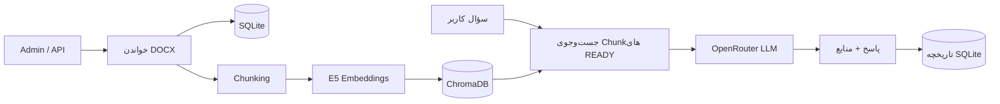

# Document QA — پرسش‌وپاسخ هوشمند از اسناد Word

[English README](README.md)

**Document QA** یک سامانه مبتنی بر **RAG** با Django است که فایل‌های Word را دریافت می‌کند، متن آن‌ها را برای جست‌وجوی معنایی آماده می‌کند و با کمک مدل زبانی، به سؤال‌های کاربران **همراه با ارجاع به سند** پاسخ می‌دهد.

این پروژه به‌عنوان نمونه‌کار **مهندسی هوش مصنوعی** ساخته شده و تمرکز آن بر پیاده‌سازی کامل یک سامانه عملی است: از دریافت فایل و پردازش متن تا بازیابی اطلاعات، اتصال به LLM، تست و مدیریت خطا.

> وضعیت پروژه: نسخه قابل اجرای محلی و دموی کارآموزی؛ نه سرویس آماده انتشار عمومی. پنل مدیریتی Django Admin است و فرانت‌اند جداگانه‌ای ندارد.

## قابلیت‌های پیاده‌سازی‌شده

- **مدیریت اسناد DOCX:** آپلود، نمایش، ویرایش، جایگزینی و حذف از طریق Django Admin یا REST API.
- **استخراج متن:** پردازش پاراگراف‌ها و جدول‌های Word و ذخیره متن در SQLite.
- **جست‌وجوی معنایی:** Chunking با LangChain، ساخت Embedding با `intfloat/multilingual-e5-small` و ایندکس در ChromaDB.
- **پرسش‌وپاسخ مستند:** بازیابی بخش‌های مرتبط و ارسال سؤال و متن بازیابی‌شده به مدل تنظیم‌شده در OpenRouter.
- **ارجاع به منابع:** نمایش شناسه سند و Chunkهای استفاده‌شده در پاسخ.
- **تاریخچه:** ذخیره پرسش‌وپاسخ‌های موفق و نمایش تاریخچه هر کاربر فقط به خودش.
- **مدیریت وضعیت ایندکس:** حالت‌های `pending`، `processing`، `ready` و `failed`، امکان Retry، و جلوگیری از بازیابی ایندکس قدیمی یا ناقص.
- **تست و ارزیابی:** تست‌های Django و یک مجموعه ارزیابی فارسی با اسناد و سؤال‌های نمونه.

## معماری



| بخش | فناوری |
| --- | --- |
| Backend و API | Python 3.11، Django، Django REST Framework |
| استخراج DOCX | `python-docx` |
| پردازش و RAG | LangChain |
| مدل Embedding | `intfloat/multilingual-e5-small` |
| دیتابیس برداری | ChromaDB |
| تولید پاسخ | OpenRouter |
| داده‌های اصلی | SQLite |
| اجرا | Docker Compose |

**تصمیم فنی مهم:** بردارسازی محلی است و مدل Embedding با اسناد آپلودشده آموزش مجدد نمی‌بیند. هنگام پرسیدن سؤال، بخش‌های بازیابی‌شده به OpenRouter ارسال می‌شوند. تغییر صرفاً عنوان سند نباید باعث تولید دوباره همه Embeddingها شود.

## اجرای پروژه با PowerShell

پیش‌نیاز: Docker Desktop، Docker Compose و برای تولید پاسخ یک کلید OpenRouter. دانلود اولیه مدل Embedding به اینترنت نیاز دارد.

```powershell
Copy-Item .env.example .env
```

متغیرهای موردنیاز را در `.env` تنظیم کن:

```dotenv
DJANGO_SECRET_KEY=replace-with-unique-secret
DJANGO_DEBUG=True
DJANGO_ALLOWED_HOSTS=localhost,127.0.0.1
OPENROUTER_API_KEY=your-private-api-key
OPENROUTER_MODEL=your-available-model
```

```powershell
docker compose up -d --build
docker compose exec web python manage.py migrate
docker compose exec web python manage.py createsuperuser
docker compose exec web python manage.py test
```

مسیرها:

- پنل مدیریت: `http://127.0.0.1:8000/admin/`
- مدیریت اسناد: `http://127.0.0.1:8000/api/documents/`
- پرسش‌وپاسخ: `http://127.0.0.1:8000/api/ask/`
- تاریخچه: `http://127.0.0.1:8000/api/history/`

سند Word را آپلود کن و وقتی وضعیت ایندکس آن `ready` شد، از طریق `/api/ask/` سؤال بپرس.

## APIهای اصلی

| متد | مسیر | کارکرد |
| --- | --- | --- |
| `GET`, `POST` | `/api/documents/` | فهرست و آپلود اسناد |
| `GET`, `PATCH`, `DELETE` | `/api/documents/{id}/` | نمایش، ویرایش و حذف سند |
| `POST` | `/api/documents/{id}/retry-index/` | تلاش مجدد برای ایندکس |
| `POST` | `/api/ask/` | پرسش از محتوای اسناد |
| `GET` | `/api/history/` | تاریخچه پرسش‌های کاربر فعلی |
| `GET` | `/api/history/{id}/` | جزئیات یک رکورد تاریخچه |

نمونه Body برای `POST /api/ask/`:

```json
{
  "question": "موضوع اصلی سند چیست؟",
  "k": 4,
  "document_id": 7
}
```

`document_id` اختیاری است. اگر مشخص نشود، جست‌وجو در کل اسناد آماده انجام می‌شود. پاسخ شامل `question`، `answer` و `sources` است.

**نکته درباره `retry-index`:** این مسیر در `documents/views.py` با `@action(methods=["post"])` تعریف شده و `SimpleRouter` در `documents/urls.py` به‌صورت خودکار آدرسش را می‌سازد. بازکردن مستقیم آن در مرورگر درخواست `GET` می‌فرستد و طبیعی است که `405 Method Not Allowed` برگردد.

## ارزیابی کیفیت

در پوشه `quality_eval/` دو سند ساختگی فارسی و ۱۶ سؤال برچسب‌دار برای بررسی بازیابی و تولید پاسخ تهیه شده است:

```powershell
# بعد از آپلود دو سند نمونه، شناسه‌ها را جایگزین کن.
docker compose exec web python manage.py evaluate_rag_quality --document-a 7 --document-b 8 --k 4

# این دستور به OpenRouter درخواست می‌فرستد و سهمیه مصرف می‌کند.
docker compose exec web python manage.py evaluate_rag_quality --document-a 7 --document-b 8 --k 4 --with-llm
```

در یک اجرای آزمایشی، طبق بررسی دستی سازنده پروژه، **۱۵ پاسخ دریافت شد و هر ۱۵ پاسخ درست ارزیابی شدند؛ یک درخواست به خطای سرویس‌دهنده برخورد کرد**. این نتیجه مربوط به همین مجموعه کوچک است و نباید به‌عنوان دقت عمومی ۱۰۰٪ معرفی شود. نرخ بازیابی، اعتبار منابع و زمان پاسخ باید از گزارش واقعی JSON/CSV استخراج شوند.

## مهارت‌های مهندسی نشان‌داده‌شده در پروژه

- طراحی REST API، Serializer، اعتبارسنجی و احراز هویت در Django.
- پیاده‌سازی زنجیره کامل RAG شامل پردازش سند، جست‌وجوی برداری و تولید پاسخ.
- استفاده از مدل Embedding محلی و دیتابیس برداری در کنار SQLite.
- مدیریت شکست ایندکس‌سازی، وضعیت پردازش و Retry بدون ایجاد سند تکراری.
- نوشتن تست واحد و یکپارچه و جداکردن تست‌های آفلاین از وابستگی به سرویس خارجی.
- راه‌اندازی برنامه با Docker و ارزیابی جداگانه کیفیت پاسخ و پایداری ارائه‌دهنده LLM.

## محدودیت‌های فعلی و گام‌های توسعه

نسخه کنونی برای یک مجموعه اسناد مشترک طراحی شده است. **تمام کاربران واردشده به API می‌توانند اسناد را مدیریت کنند**؛ محدودسازی نوشتن به Staff یا تفکیک مالکیت اسناد هنوز اضافه نشده است. همچنین ایندکس‌سازی هم‌زمان و روی CPU اجرا می‌شود؛ خطا و محدودیت سهمیه OpenRouter نیز خارج از کنترل برنامه است. SQLite و ChromaDB تراکنش مشترک ندارند، هرچند وضعیت ایندکس و Retry ریسک ناسازگاری را کاهش می‌دهد.

بهبودهای ممکن در نسخه‌های بعدی، **نه قابلیت‌های فعلی**: صف پردازش برای ایندکس‌سازی، مجوزهای دقیق‌تر کاربران، ارزیابی روی داده‌های بزرگ‌تر، Reranking و پایش سرویس در محیط Production.

---

*این پروژه یک نمونه‌کار اجرایی برای نشان‌دادن توانایی توسعه Backend و سامانه‌های هوش مصنوعی مبتنی بر RAG است.*
